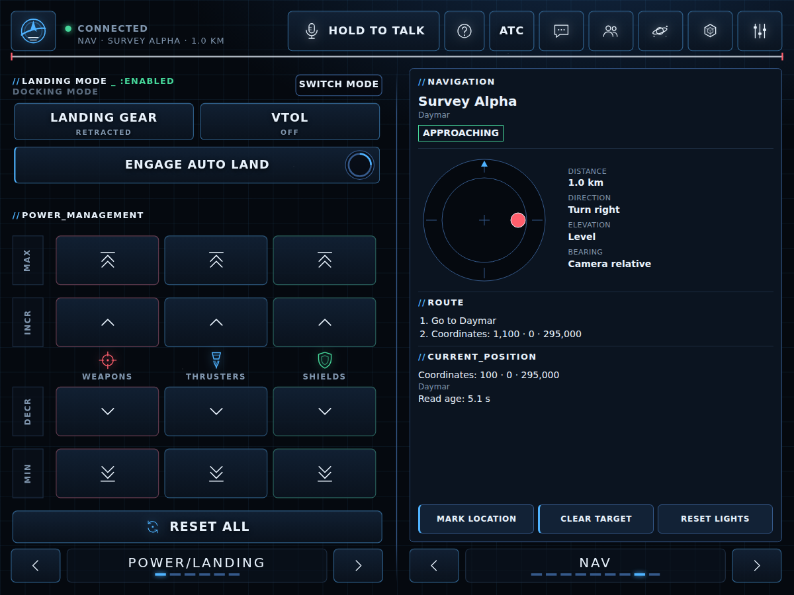
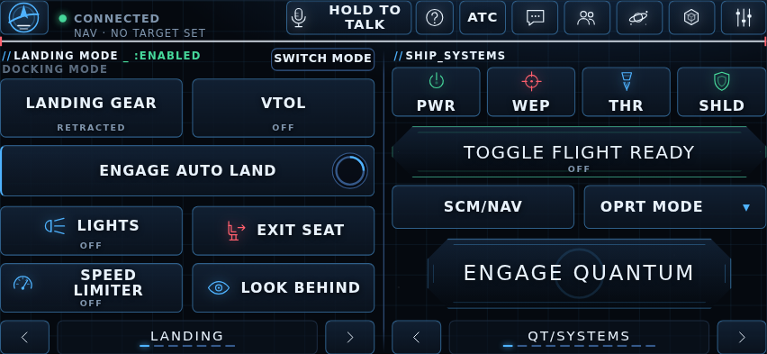
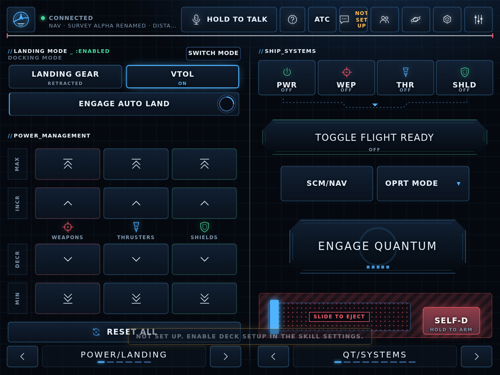

# SC Voice-Cockpit

**Voice controls, a tablet cockpit and personal waypoint navigation for Star Citizen.**
By **Dominicus**, combining SC_Keybindings, nodieCode's Tablet Deck and Mallachi's NavPoint.
Unofficial fan project · [GPL-3.0](LICENSE) · [credits and third-party notices](NOTICE.md).

Ask which key your own profile uses, send verified Wingman commands from a phone or tablet,
and mark or navigate to your own saved locations. Voice and tablet actions share remembered
system lights; the navigation desk stays on the same page.

## Synthetic preview







All locations and controls shown here are synthetic test data, not a live player profile.
The [startup card text](docs/startup-card.png) is a synthetic preview, not a capture of the Wingman client.

## Requirements

- Windows x64, Wingman AI **3.2.11+**, **Skill API v3**. Tested against 3.2.11.
- Star Citizen **4.10.x**; action compatibility qualified against 4.10.2.
- Borderless windowed mode for the ring overlay. It follows the game's monitor.
- For NavPoint, manually enter **`r_displayinfo 2`** in the game console.
- A phone/tablet browser on the same trusted local network. No cloud service is required.
- Node.js is optional: game-default extraction has a bundled Python fallback.

## Install or update

1. Download `SC-Voice-Cockpit-1.2.0.zip` from
   [Releases](https://github.com/astra-openclaw/wingman-sc-voice-cockpit/releases).
2. Close Wingman. Extract into `%APPDATA%\ShipBit\WingmanAI\custom_skills`.
   The result must be `custom_skills\sc_voice_cockpit\main.py`, without another wrapper.
3. Restart Wingman and enable **SC Voice-Cockpit** on your chosen wingman.
4. Leave **Game folder** at `auto`, or choose the installation containing `Data.p4k`.
   Wait for the first index extraction, then try “Which key is the quantum drive?”

The release includes the official Windows OpenCV binaries; do not install another Python
or copy native libraries manually. Source checkouts exclude those binaries: use the release
builder described below. Updates replace the skill folder, not its generated data.
Always restart the whole Wingman app after replacing files; a configuration reload alone
can retain old imported modules. Preserve waypoints, pairing data, calibration and backups.

**Do not enable the old SC_Keybindings or SC_NavPoint on the same wingman.** The combined
skill replaces their tools; old NavPoint also competes for port **7869**. Disable those
skills without deleting their data. Existing separate-skill data is not automatically imported;
advanced migration helpers are in `tools/` in the source repository.

## First run: deck setup is your choice

**Set up deck commands and keybinds (`deck_setup`) defaults to off.** The deck and NavPoint
still serve. Missing command/key controls show **Not set up** and a tap presses nothing.
The startup card explains setup, after the same 15-second startup delay as pairing.
Existing commands retain the normal key-lookup and drift-guard features and settings.

To populate the deck, close Star Citizen and switch **Set up deck commands and keybinds**
on in this skill's settings. Setup adds Wingman commands, appends silent light-sync actions
to matching commands, and binds globally free keyboard combinations in
`user/client/0/Profiles/default/actionmaps.xml`. It does not import a wholesale control profile.
Profile and command changes are backed up in the generated-files backup area; existing
user edits and deliberate clears are respected. Wingman must finish its startup registration
before command persistence can complete; this may take up to two minutes. Reopen the Wingman
client after the initial setup before editing commands, so its cached configuration is current.

If Star Citizen is running or its state is uncertain, profile changes defer. Close the game
and restart/reload the skill to retry. Switching setup off stops future pack changes; it does
**not** remove already installed commands, keys or personal data. The independent inherited
command-repair and restore settings keep their documented behavior.

Earlier combined-pack installations are recognized by their generated pre-1.2 deck manifest
and retain setup automatically. The generated `deck_setup.json` records that decision and
subsequent live switch changes. Wingman 3.2.11 exposes merged settings, not whether a false
value was saved before the first 1.2 start; see the migration limitation below.

### Undo and Fresh start

To undo setup, close Wingman and Star Citizen, keep a copy of all current data, and restore
the pre-setup `actionmaps.xml` backup. Restore the saved commands through Wingman's command
editor/import (or remove only the commands you added). Preserve unrelated commands and settings.
Turn setup off before resuming. Do not delete waypoint or calibration data.

**Fresh start: re-import everything** rebuilds derived keybinding state and rechecks controls;
it does **not** uninstall deck commands or revert the game profile. It backs up small state
files first. With setup on it also reapplies the pack; turn setup off before using it to
re-index a restored profile. Optional **Restore listed custom keys** can restore keys again;
leave it off when undoing setup. Backups rotate, so copy any required pre-setup backup elsewhere.

## Pair a tablet

Open the startup card's link/QR code, or create a command using the skill action
**Show tablet deck pairing**. On a phone/tablet on the same LAN, enter the displayed pairing
code if prompted. Pairing links survive browser restarts; keep both code and links private.
Allow the local listener through the Windows firewall only on the intended private network.

The listener is **LAN only**, checks client/Host addresses, and authenticates pairing and
same-origin mutations. Nothing is exposed to the internet by this skill. Do not port-forward
it, publish its URL, or put it behind a public proxy. LAN HTTP is not encrypted: use a trusted
network, not public Wi-Fi. Anyone holding a valid pairing link on that LAN can control the deck.

The NAV/WAYPOINTS panels offer targeting, body filters, rename, notes and confirmed delete.
They do not open another page or steal game focus. Tablet microphone hold uses the **PC's
Wingman microphone**, not the tablet microphone.

## Settings

| Setting | Default | Purpose |
| --- | --- | --- |
| `deck_setup` | off | Opt in to pack commands and profile bindings |
| `deck_enabled` | on | Enable tablet control; navigation remains available |
| `deck_port` | 7869 | Local web listener; avoid conflicts with old NavPoint |
| `deck_feedback` | ai | `off`, `note`, `speak` or short tool-free AI feedback |
| `deck_tablet_mic` | on | Hold to talk using the PC microphone |
| `deck_emotes` | on | Show emote controls; off hides them, not existing commands |
| `game_folder` | auto | Installed LIVE folder, or an explicit PTU/EPTU folder |
| `endearments` | empty | Optional spoken suffixes; no personal words ship |
| `auto_update_commands` | on | Repair verified moved keys in existing commands |
| `restore_custom_binds` | off | Restore listed missing custom keys while the game is closed |
| `fresh_start` | off | One-shot derived-state rebuild; switch off to re-arm |
| `display` | 1 | Ring monitor fallback when the game window cannot be found |
| `overlay_size` | 220 | Ring size; live changes restart only the ring |
| `arrival_alert_distance` | 1000 | Approach warning distance, metres |
| `arrival_stop_distance` | 250 | Navigation stop distance, metres |

Setup reserves the generic Wingman cancel/mute shortcuts and reads your `record_key`,
`record_mouse_button`, cancel-TTS and voice-activation mute keys through the public configuration
facade. No separate-tool personal shortcuts are reserved. Review other global shortcuts yourself.
New binds use one modifier and ordinary keys or F1–F12; numpad and extended navigation keys
are excluded because Wingman sends numpad keys by name and may lose extended-key identity.

## Limits and troubleshooting

- Lights are **remembered intent**, not game telemetry. Use **Fix a light** or tell your
  wingman the light is wrong. That changes only the indicator, never the ship. Reset Lights
  clears all remembered lights. Where available, a tap selects a verified explicit on/off command.
- Emotes work **only on foot**. “Sent” means a key was sent, not proof the animation played.
  No-key/Not-set-up taps are inert. Voice command tails cannot retract keys already sent by Core.
- Tablet key actions require Star Citizen in the foreground. Voice commands use Wingman's normal
  executor; ensure the game has focus. Holds release on finger-up, disconnect, heartbeat timeout
  or unload. A Core macro already started cannot be forcibly cancelled through the public API.
- A missing ring usually means exclusive fullscreen, no trustworthy fix or an unavailable
  game window. Use borderless windowed and ensure the position overlay is readable. Open-space
  guidance can be distance-only; never infer a missing bearing.
- If pairing fails, check same LAN, private-network firewall access, port conflicts and the
  current pairing card. No router changes are required.
- If speech recognition stutters or logs flood, check whether **Game.log** is growing rapidly.
  An in-game notification loop can starve Wingman's game-log readers. Relog or change server;
  reinstalling this skill does not fix that game loop.
- Existing user-edited or ambiguous player/UI commands may remain unverified. A clean drift
  report is not proof of in-game animation, model adherence or every game context.
- **Migration limitation:** on the first upgrade from a pre-1.2 pack, the public API cannot
  distinguish a newly defaulted false setting from an explicit false saved before that start.
  Legacy pack evidence wins once. To explicitly disable a migrated installation, switch setup
  on and then off in the running skill; the durable off choice survives restarts. Fresh players
  are never migrated. No raw configuration or private Core API is read to bypass this limitation.

## Build and test from source

Use Python 3.11+ in a temporary virtual environment. Install `requirements-dev.txt`, then run:

```sh
python -m pytest -q -p no:cacheprovider tests
python tests/keybindings/static_check.py
python tests/compatibility.py --reference /path/to/wingman-ai-3.2.11 --loader /path/to/wingman-ai-3.2.11/services/module_manager.py
python tests/keybindings/compatibility.py --reference /path/to/wingman-ai-3.2.11 --loader /path/to/wingman-ai-3.2.11/services/module_manager.py
python tests/fake_server.py --selftest --artifacts /tmp/cockpit-browser
python tools/build_release.py
python tools/build_release.py --out /tmp/cockpit-rebuild
```

The genuine API probes require the official Wingman source reference. The browser selftest
requires Google Chrome. Optional game-extract/private-fixture tests skip when not configured;
portable tests and browser screenshots use synthetic data. The builder obtains the official
OpenCV wheel over HTTPS, verifies PyPI's digest and the two embedded binary hashes, and caches
it outside the repository. ZIP timestamps, permissions and member ordering are fixed; use the
same Python/zlib toolchain for byte-identical rebuilds. `dist/SHA256SUMS` identifies the result.

## Credits and license

SC Voice-Cockpit and SC_Keybindings: **Dominicus**. Tablet Deck: **nodieCode**, MIT.
NavPoint: **Mallachi**, GPL-3.0, from [Diftic/wingman-skills](https://github.com/Diftic/wingman-skills).
The combined skill is GPL-3.0; the full MIT notices and NavPoint modification notice are in
[NOTICE.md](NOTICE.md). OpenCV and its bundled dependencies retain their original licenses.
Star Citizen and Wingman AI are trademarks/products of their respective owners; this project
is not affiliated with Cloud Imperium Games or ShipBit.
